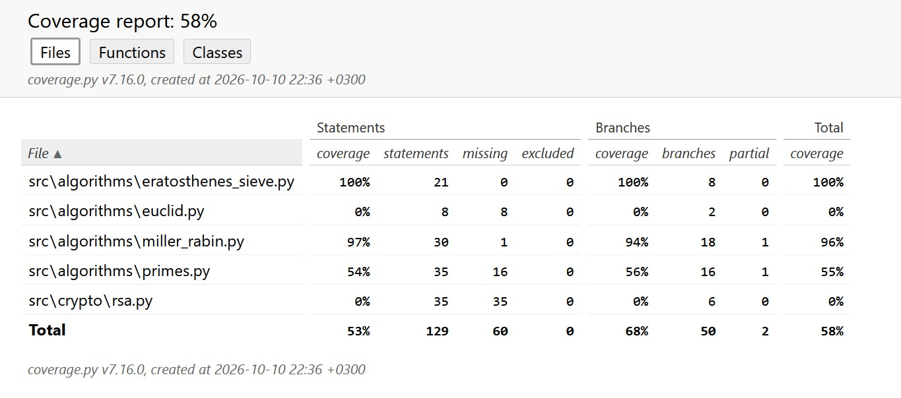

# Testaus

Ohjelmaa on testattu `Windows 11` ja `Ubuntu` -käyttöjärjestelmillä.

## Algoritmien testaus

### Eratostheneen seula

Eratostheneen seula on yksikkötestattu TestErathosthenesSieve-luokalla. Luokka testaa, että get_primes_list-metodi paluttaa alkuluvut listassa ja tarkistaa, että alkuluvut ovat oikein tapauksissa, joissa ne on laskettu lukuihin 2, 11 ja 100 asti. Lisäksi ohjelmaa on ajettu komentoriviltä, jossa olen syöttänyt luvun, johon asti haluan luoda alkulukuja, jolloin ohjelma on tulostanut syöttämääni lukua pienemmät alkuluvut ja syöttämäni luvun, jos se oli alkuluku. Listat ovat olleet vielä pieniä. Suurin syöte on ollut 100, jonka olen tarkistanut.

### Miller-Rabin

Miller-Rabin-algoritmiä on testattu TestMillerRabin-luokalla. Algoritimiä on testattu kahdeksan, kymmenen, 38 100, 290 ja 300 -yksikköisillä tunnetuilla alkuluvuilla ja niiden tuloista saaduilla yhdistetyillä luvuilla. Lisäksi sitä on testattu luvuilla yksi, kaksi, kolme sekä negatiivisella luvulla. Koska kyseiselle Miller-Rabinille annetaan alaraja, jotta se ei testaisi Eratostheneen seulan lukuja on algoritmiä testattu alarajalla, joka on suurempi kuin alkulukuehdokas - 2. Tällöin algoritmi asettaa uudeksi alarajaksi luvun kaksi, jolloin se edelleen toimii.

### PrimesGenerator-luokka

PrimesGenerator-luokkaa on testattu luokalla TestPrimesGenerator, joka testaa metodia is_prime kolme, neljä, kahdeksan, kymmenen, 35 100, 290 ja 300 -yksikköisillä tunnetuilla alkuluvuilla ja niiden tuloista saaduilla yhdistetyillä luvuilla sekä ääriarvolla 2.

### RSACrypto-luokka

RSACrypto-luokkaa on testattu luokalla TestRSACrypto. Testiuokka testaa, että generate_keys-metodi tuottaa bittikooltaan suurempia avaimia kuin RSACrypto-luokan key_size-attribuutti, mutta kuitenkin pienempiä kuin key_size tuplattuna. Tätä se testaa attribuutin arvoilla 64 ja 2048. Testiluokka testaa myös, että metodi palauttaa Dictonary-tietorakenteen, joka sisältää kaksi Tuple-rakennetta, joista löytyy avainparit kokonaislukuina.

Lisäksi, testiluokka testaa encrypt_text ja decrypt_text -metodeja eri merkkejä ja numeroita sisältävillä eri kokoisilla viesteillä sekä eri kokoisilla avaimilla, joidenka key_size-attribuutin arvo on väliltä 64-2048 bittiä. encrypt_text-metodin palautusarvoja on vertailtu eri ajoissa, kun ajoissa on syötetty sama viesti ja avain, sama viesti, mutta eri avain sekä eri viesti ja sama avain. Kyseisen metodin palautusarvon kokoa on myös verrattu avaimen kokoon. encrypt_text-metodi nostaa MessageIsTooLong-poikkeuden, kun viesti on suurempi tai yhtä suuri kuin avaimen modulus, jota testiluokka testaa myös.

## Testikattavuus

