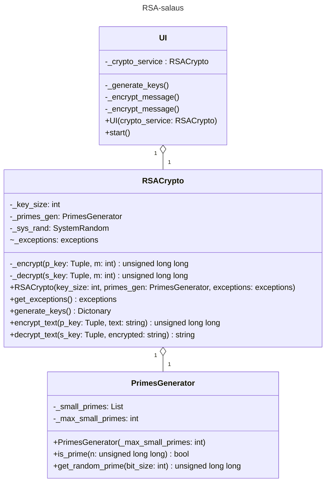

# Toteutus

## Luokkakaavio

## Saavutetut aika- ja tilavaativuus

**Avainten luonti** O(kn^3), missä n on Miller-Rabinin testaaman luvun bittien määrä ja k testattujen lukujen määrä ennen kuin alkuluku löytyy\
**Salaamisen ja salauksen purkamisen aikavaativuus:** O(n), missä n on salatun viestin pituus bitteinä\
**Tilavaativuus molemmissa tapauksissa:** O(n), missä n on salattavan tai purettavan viestin pituus bitteinä

## Parannusehdotukset

Käyttöliittymää voisi parantaa mahdollistamalla avainten ja viestien tulostamisen tekstitiedostoihin ja niiden lukemisen tekstitiedostoista. Nykyinen syöttötapa on kovin työläs ja riskialtis käyttäjän virheille. Lisäksi täytteen voisi kokeilla implementoida turvallisuuden lisäämiseksi ja ratkaisu pitkien viestien salaamiseen olisi pätevä löytää.

## Kielimallien käyttö

En ole käyttänyt laajoja kielimalleja työssäni.

## Lähteet

Cormen, Thomas H., Leiserson, Charles E., Rivest, Ronald L.ja Stein, Clifford: *Intoduction to Algorithms, Third Edition*, sivut 933-950, 958-975 Cambridge, Massachusetts, London, England, 2009, The MIT Press, ISBN 978-0-262-03384-8.

*Eratostheneen seula*. Wikipedian sivu, 2024. https://fi.wikipedia.org/wiki/Eratostheneen_seula, vierailtu 2026-09-26.

*Miller–Rabin primality test*. Wikipedian sivu, 2026. https://en.wikipedia.org/wiki/Miller%E2%80%93Rabin_primality_test, vierailtu 2026-09-26.

*Primality Test | Set 3 (Miller–Rabin)*. GeeksforGeeks-sivuston sivu, 2025. https://www.geeksforgeeks.org/dsa/primality-test-set-3-miller-rabin/, vierailtu 2026-09-26.

*random — Generate pseudo-random numbers*. Pythonin dokumentaation sivu, 2026. https://docs.python.org/3/library/random.html, vierailtu 2026-09-26.

*secrets — Generate secure random numbers for managing secrets*. Pythonin dokumentaation sivu, 2026. https://docs.python.org/3/library/secrets.html, vierailtu 2026-09-26.

*Random Small Primes - 10 to 100 digits (page 1 of 3)*. PrimePages-sivuston sivu, 2021. https://t5k.org/lists/small/small.html, vierailtu 2026-10-03.

*Random Small Primes - 210 to 300 digits (page 3 of 3)*. PrimePages-sivuston sivu, 2021. https://t5k.org/lists/small/small3.html, vierailtu 2026-10-03.

*List of prime numbers*. Wikipedian sivu, 2026. https://en.wikipedia.org/wiki/List_of_prime_numbers, vierailtu 2026-10-03.

*Modular Multiplicative Inverse*. Algorithms for Competitive Programming -sivuston sivu, 2025. https://cp-algorithms.com/algebra/module-inverse.html#finding-the-modular-inverse-for-prime-moduli-using-euclidean-division, vierailtu 2026-10-10.

*Extended Euclidean Algorithm*. Algorithms for Competitive Programming -sivuston sivu, 2025. https://cp-algorithms.com/algebra/extended-euclid-algorithm.html, vierailtu 2026-10-10.

*Python Program for Extended Euclidean Algorithms*. GeeksforGeeks-sivuston sivu, 2025. https://www.geeksforgeeks.org/python/python-program-for-basic-and-extended-euclidean-algorithms-2/, vierailtu 2026-10-10.

Liu, David ja Badr, Mario: *Foundations of Computer Science, Course Notes for CSC110 and CSC111: 8.5 Implementing RSA in Python*. Toronton yliopiston verkkosivu, 2026. https://www.teach.cs.toronto.edu/~csc110y/fall/notes/08-cryptography/05-rsa-cryptosystem-implementation.html, vierailtu 2026-10-10.

*RSA cryptosystem*. Wikipedian sivu, 2026. https://en.wikipedia.org/wiki/RSA_cryptosystem, vierailtu 2026-10-10.

*Built-in Types*. Pythonin dokumentaation sivu, 2026. https://docs.python.org/3/builtins/stdtypes.html, vierailtu 2026-10-22.

*Bézout’n lemma*. Wikipedian sivu, 2023. https://fi.wikipedia.org/wiki/B%C3%A9zout%E2%80%99n_lemma, vierailtu 2026-10-23.